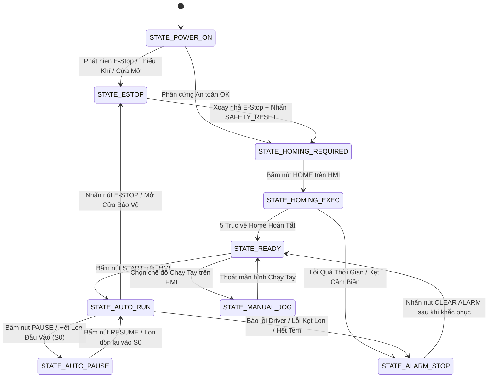

# FIRMWARE & PROCESS CONTROL SPECIFICATION: PMeMS CONTROLLER 1
## DÂY CHUYỀN CHỈNH GÓC & DÁN TEM NẮP LON TỰ ĐỘNG (NAM VIET F&B)

> **Tài liệu đặc tả logic quy trình công nghệ & kiến trúc Firmware (Single Source of Truth cho Claude Code, Cursor, PlatformIO).**  
> **Phiên bản:** REV 3.2 (Thống nhất 100% với Hardware Spec V3.2)  
> **Bộ điều khiển trung tâm:** STM32F407VET6 (168MHz, 512KB Flash, 192KB RAM)  
> **Hệ điều hành thời gian thực:** FreeRTOS (CMSIS-RTOS v2)  

---

## MỤC 1: BẢNG TỌA ĐỘ KHÔNG GIAN CÁC TRẠM THEO ENCODER BĂNG TẢI M1

Dây chuyền sử dụng băng tải xích nhựa `CAP820-82` (rộng 106 mm, dài 2 m), kéo bởi động cơ giảm tốc AC điều khiển bằng Biến tần M1.  
Vị trí của mọi lon trên băng tải được bám sát tuyệt đối theo thời gian thực nhờ **Encoder trục quay quang học** gắn tại trục chủ động của băng tải, đọc bởi kênh phần cứng `TIM2` (`PA0` / `ENC_A`, `PA1` / `ENC_B`, chế độ `TIM_ENCODERMODE_TI12`).

### 1.1. Các thông số động học cơ bản:
* **Hệ số xung Encoder:** $K_{enc} = 10.0\text{ xung/mm}$ ($1\text{ xung} = 0.1\text{ mm}$).
* **Bước lon thiết kế:** $P_{can} = 120.0\text{ mm}$ (khoảng cách tâm giữa 2 lon liên tiếp khi cơ cấu chặn P1/P2 nhả lon).
* **Năng suất định mức:** $120\text{ lon/phút}$ (tối đa $156\text{ lon/phút}$).
* **Tốc độ băng tải ở 120 lon/phút:** $V_{belt} = \frac{120 \times 120\text{ mm}}{60\text{ s}} = 240\text{ mm/s}$ (Tần số xung Encoder = $2,400\text{ Hz}$).
* **Tốc độ băng tải tối đa (156 lon/phút):** $V_{max} = \frac{156 \times 120\text{ mm}}{60\text{ s}} = 312\text{ mm/s}$ (Tần số xung Encoder = $3,120\text{ Hz}$).

### 1.2. Tọa độ các trạm máy tính từ Cảm biến quang S2 ($X_0 = 0\text{ mm}$):

| Trạm | Thiết bị / Cơ cấu | Vị trí $X$ (mm) | Tọa độ Encoder (xung) | Sai số cho phép ($\pm$) | Tác vụ thời gian thực tương ứng |
|:---:|:---|:---:|:---:|:---:|:---|
| **0** | **Cảm biến quang S2** | $0.0\text{ mm}$ | $0\text{ xung}$ | $\pm 0.2\text{ mm}$ | Ngắt `EXTI2` kích hoạt: Đọc ngay `TIM2->CNT`, cấp `can_id` mới, đẩy vào FIFO Tracking. |
| **1** | **Điểm chụp ảnh Camera Hikrobot** | $+50.0\text{ mm}$ | $+500\text{ xung}$ | $\pm 1.0\text{ mm}$ | Kích ngõ ra `CAM_TRIG` (`PD14`) phát xung $10\ \mu\text{s}$ mở đèn Strobe và chụp ảnh nắp lon. |
| **2** | **Trạm chỉnh góc lon** (Chốt P3, Kẹp P4, Bánh PU M2) | $+300.0\text{ mm}$ | $+3,000\text{ xung}$ | $\pm 1.5\text{ mm}$ | P3 đóng chốt chặn $\rightarrow$ P4 kẹp lon $\rightarrow$ Motor M2 quay góc bù $\theta$ $\rightarrow$ P4 nhả $\rightarrow$ P3 mở. |
| **3** | **Trạm dán tem** (Mâm xoay 6 đầu M3, Xi lanh P5) | $+650.0\text{ mm}$ | $+6,500\text{ xung}$ | $\pm 0.5\text{ mm}$ | Đồng bộ hạ xi lanh P5 (`SDA40×20`), ngắt hút chân không và kích xung thổi xả để dán tem. |
| **4** | **Cảm biến kiểm tra tem S5** | $+950.0\text{ mm}$ | $+9,500\text{ xung}$ | $\pm 2.0\text{ mm}$ | Đọc tín hiệu cảm biến màu/tương phản S5 để xác nhận lon đã có tem chuẩn. |
| **5** | **Xi lanh đẩy loại lon lỗi P8** | $+1,250.0\text{ mm}$| $+12,500\text{ xung}$ | $\pm 5.0\text{ mm}$ | Nếu lon mang cờ lỗi (`NG_CAMERA`, `NG_VACUUM`, `NG_LABEL`), kích P8 gạt lon ra máng. |
| **End**| **Cuối băng tải ra lon đạt** | $+2,000.0\text{ mm}$| $+20,000\text{ xung}$ | — | Lon đạt chuẩn chạy ra băng tải chuyền tiếp theo; hủy record khỏi FIFO. |

### 1.3. Cấu trúc dữ liệu theo dõi lon (Can Tracking FIFO):
Mỗi lon di chuyển trên băng tải được quản lý bằng một bản ghi trong hàng đợi FIFO (tối đa 32 lon cùng lúc trên hành trình 2 mét):
```c
typedef enum {
    CAN_STATUS_INIT        = 0x00,
    CAN_STATUS_VISION_WAIT = 0x01,
    CAN_STATUS_VISION_OK   = 0x02,
    CAN_STATUS_ORIENTED    = 0x04,
    CAN_STATUS_LABELED     = 0x08,
    CAN_STATUS_INSPECTED   = 0x10,
    CAN_STATUS_REJECTED    = 0x20,
    CAN_STATUS_PASSED      = 0x40,
    CAN_ERROR_VISION_NG    = 0x80,
    CAN_ERROR_VACUUM_MISS  = 0x81,
    CAN_ERROR_LABEL_MISS   = 0x82
} CanStatus_t;

typedef struct {
    uint16_t   can_id;            // Mã định danh lon tăng dần (1 .. 65535)
    uint32_t   enc_capture_s2;    // Giá trị TIM2->CNT chụp ngay tại ngắt EXTI2
    float      theta_degree;      // Góc lệch khoen lon trả về từ Camera Vision (-180.0° .. +180.0°)
    uint8_t    station_idx;       // Chỉ số trạm lon đang tiếp cận (0 .. 5)
    CanStatus_t status;           // Cờ trạng thái hiện tại
    uint32_t   timestamp_enter;   // Thời gian lon đi vào trạm S2 (TickCount)
} CanRecord_t;
```

---

## MỤC 2: GIAO THỨC TRUYỀN THÔNG VISION TRÊN RS485_3

Cổng `RS485_3` trên Board Mẹ (`UART4`, `PC10` TX, `PC11` RX, `PD3` DIR) kết nối trực tiếp với Máy tính Xử lý Ảnh Công nghiệp (Industrial PC Vision) chạy thuật toán nhận dạng khoen lon.

### 2.1. Cấu hình phần cứng UART4:
* **Baud rate:** $115,200\text{ bps}$
* **Khung truyền:** 8 Data bits, No Parity, 1 Stop bit (8N1).
* **Điều khiển chiều RS485:** Chân `PD3`: `1` = Truyền (TX), `0` = Nhận (RX). Đổi chiều trước TX 5 µs và sau TX 15 µs (khi cờ `USART_SR_TC = 1`).
* **Cơ chế nhận:** Nhận bằng DMA Circular kết hợp ngắt `UART_IT_IDLE` để phát hiện kết thúc gói tin cực nhanh không phụ thuộc độ dài.

### 2.2. Định dạng gói tin nhị phân (Binary Protocol Packet Frame):

#### A. Gói tin Master gửi sang Vision PC (Trigger Request):
Sau khi S2 phát hiện lon, MCU có thể gửi gói tin thông báo mã lon:
| Byte | Tên trường | Giá trị | Ý nghĩa |
|:---:|:---|:---:|:---|
| **0** | `HEADER_1` | `0x55` | Mã mở đầu chuẩn |
| **1** | `HEADER_2` | `0xAA` | Mã mở đầu chuẩn |
| **2** | `CMD` | `0x10` | Lệnh: `CMD_TRIGGER_INSPECT` |
| **3..4** | `CAN_ID` | `uint16_t` | Số thứ tự lon cần nhận diện (Little-Endian) |
| **5..6** | `CRC16` | `uint16_t` | Checksum CRC16 Modbus (tính từ Byte 0..4) |
| **7** | `TAIL` | `0x0A` | Kết thúc gói tin (`\n`) |

#### B. Gói tin Vision PC trả kết quả về Master (Vision Response):
| Byte | Tên trường | Kiểu dữ liệu | Ý nghĩa |
|:---:|:---|:---:|:---|
| **0** | `HEADER_1` | `uint8_t` | Cố định `0xAA` |
| **1** | `HEADER_2` | `uint8_t` | Cố định `0x55` |
| **2** | `CMD` | `uint8_t` | Cố định `0x20` (`CMD_VISION_RESULT`) |
| **3..4** | `CAN_ID` | `uint16_t` | Mã lon đối soát (phải khớp với ID đã kích) |
| **5..6** | `THETA_X100` | `int16_t` | Góc bù $\theta \times 100$. Ví dụ: $+35.42^\circ \rightarrow +3542$; $-12.50^\circ \rightarrow -1250$ |
| **7** | `QUALITY_FLAG` | `uint8_t` | `0x00`: Nhận diện Tốt (OK)<br>`0x01`: Không tìm thấy khoen (NG_NO_TAB)<br>`0x02`: Màng co che khuất / Nắp biến dạng (NG_DEFECT)<br>`0x03`: Lon ngược đầu / Nắp sai loại (NG_WRONG_TYPE) |
| **8..9** | `CRC16` | `uint16_t` | Checksum CRC16 Modbus (tính từ Byte 0..7) |
| **10** | `TAIL` | `uint8_t` | Cố định `0x0D` (`\r`) |
| **11** | `TAIL` | `uint8_t` | Cố định `0x0A` (`\n`) |

### 2.3. Quy tắc xử lý Timeout & Sự cố Vision:
* **Thời gian chờ tối đa (Vision Timeout Window):** $T_{timeout} = \mathbf{80\text{ ms}}$ tính từ lúc ngõ ra `CAM_TRIG` phát xung.
* **Xử lý Timeout:** Nếu sau 80 ms chưa nhận được phản hồi từ PC Vision:
  1. Gán cờ lỗi `CAN_ERROR_VISION_NG` cho lon tương ứng.
  2. Bỏ qua trạm chỉnh góc (P3/P4 giữ nguyên mở, M2 không quay).
  3. Bỏ qua trạm dán tem (không kích P5 hạ dán).
  4. Khi lon chạy đến trạm loại ($X = 1,250\text{ mm}$), kích xi lanh P8 đẩy lon ra máng phế phẩm.
  5. Nếu xảy ra 3 lon liên tiếp bị Timeout $\rightarrow$ Dừng máy báo động `ALM_05_VISION_COMM_TIMEOUT`.

---

## MỤC 3: BIỂU ĐỒ THỜI GIAN (TIMING CHART) TRẠM DÁN TEM 6 ĐẦU HÚT

Cụm dán tem gồm mâm xoay Servo 6 vị trí (M3), xi lanh khí nén nâng hạ dán P5 (`SDA40×20`), và cụm 6 giác hút chân không điều khiển qua cụm van solenoid tích hợp `ZZQ108-L0B`.

```
Góc mâm xoay:  0° (Cấp tem)     60° (Kiểm tra)    120° (Chờ)    180° (Dán lon)    240° (Xả/Vệ sinh)  300° (Sẵn sàng)
               |                     |                 |               |                 |                  |
Vị trí lon:    |                     |                 |            [LON TỚI]            |                  |
               |                     |                 |               |                 |                  |
Đầu hút 1:    [BẬT HÚT] ---------> [TEST ÁP] ---------> | --------> [HẠ DÁN P5] -------> [THỔI XẢ] ---------> |
                                                                       |
Xi lanh P5:                                                        [XUỐNG 20mm]
                                                                       | (dán 40ms)
                                                                   [LÊN TRẦN]
```

### 3.1. Phân bổ góc quay và chức năng 6 đầu hút:
* Vị trí $0^\circ$ (Trạm cấp tem): Đầu hút tiếp cận làn tem vừa được cấp ra từ M4/M5.
* Vị trí $60^\circ$ (Trạm kiểm tra chân không): Cảm biến áp suất chân không đo độ kín.
* Vị trí $120^\circ$ (Trạm chuyển tiếp): Giữ chặt tem trong lúc mâm xoay tăng tốc.
* Vị trí $180^\circ$ (Trạm dán lên lon): Đầu hút nằm ngay trên mặt nắp lon đang chạy trên băng tải.
* Vị trí $240^\circ$ (Trạm xả khí làm sạch): Thổi khí áp lực cao vệ sinh bụi nhãn.
* Vị trí $300^\circ$ (Trạm chờ): Sẵn sàng cho chu kỳ tiếp theo.

### 3.2. Chế độ vận hành của Trục M3: Index 60° từng bước (Index Stepping):
Để đảm bảo độ chính xác cơ học tuyệt đối khi dán, mâm xoay M3 vận hành theo chu kỳ bước 60°:
* **Thời gian 1 chu kỳ lon (ở 150 lon/phút):** $T_{cycle} = \mathbf{400\text{ ms}}$.
* **Giai đoạn 1: M3 quay 60° ($0\text{ ms} \rightarrow 150\text{ ms}$):**
  * Thời gian tăng tốc: $35\text{ ms}$.
  * Thời gian quay đều: $80\text{ ms}$.
  * Thời gian giảm tốc: $35\text{ ms}$.
* **Giai đoạn 2: M3 dừng tì tĩnh ($150\text{ ms} \rightarrow 400\text{ ms}$, Dwell Time = $250\text{ ms}$):**
  * Tại Trạm Cấp ($0^\circ$): Bật van hút chân không `DO_VAC_x = 1`. Sau $30\text{ ms}$, kích xung van thổi `DO_BLOW_ASSIST` (P7) $30\text{ ms}$ để nhả tem từ lưỡi bóc dính vào núm hút.
  * Tại Trạm Kiểm tra ($60^\circ$): Sau khi dừng $50\text{ ms}$, đọc ngõ vào công tắc chân không `DI_VAC_SW_x`:
    * Nếu áp suất $P \le -45\text{ kPa}$ $\rightarrow$ Hút tem thành công (`VACUUM_OK`).
    * Nếu áp suất $P > -45\text{ kPa}$ $\rightarrow$ Hút trượt tem (`VACUUM_MISS`), đánh dấu đầu hút đó bị hụt tem.
  * Tại Trạm Dán ($180^\circ$):
    * Thời điểm $t = 160\text{ ms}$: Kích van `DO_CYL_P5 = 1` hạ xi lanh SDA40x20 xuống hành trình 20mm (thời gian xi lanh đi xuống: $45\text{ ms}$).
    * Thời điểm $t = 210\text{ ms}$: Núm hút ép tem chặt lên nắp lon (thời gian ép dán: $40\text{ ms}$).
    * Thời điểm $t = 220\text{ ms}$: Ngắt van hút `DO_VAC_x = 0`, kích van thổi xả chân không `DO_VAC_BLOW = 1` trong $30\text{ ms}$ để tem tách rời núm hút bám vào nắp lon.
    * Thời điểm $t = 250\text{ ms}$: Kích van `DO_CYL_P5 = 0` kéo xi lanh SDA40x20 thu về vị trí trần (thời gian thu về: $45\text{ ms}$). Cảm biến từ báo xi lanh đã thu về an toàn trước khi $t = 380\text{ ms}$.

---

## MỤC 4: BẢNG THÔNG SỐ ĐỘNG HỌC 6 TRỤC PHÁT XUNG (MOTION KINEMATICS)

| Thông số | Trục M2 (Chỉnh góc) | Trục M3 (Mâm xoay) | Trục M4 (Kéo tem) | Trục M5 (Dịch làn) | Trục M6a/b (Nâng hạ) |
|:---|:---:|:---:|:---:|:---:|:---:|
| **Loại động cơ** | HBS57 Vòng kín (3 N·m) | AC Servo 400W | HBS57 Vòng kín | Bước 57 Vòng kín | 2x HBS57 có phanh 24V |
| **Cơ cấu truyền động** | Bánh PU Ø95 nối thẳng | Bàn xoay rỗng 1:10 | Puly răng 16:32 + Rulo | Vít me bi Ø12 bước 10 | 2x Vít me bi 1605 bước 5 |
| **Xung/vòng Driver (PPR)**| $1,600\text{ xung/vòng}$ | $10,000\text{ xung/vòng}$ | $1,600\text{ xung/vòng}$ | $1,600\text{ xung/vòng}$ | $1,600\text{ xung/vòng}$ |
| **Tỉ số truyền cơ khí** | $1 : 1$ | $1 : 10$ | $1 : 2$ (giảm tốc) | $1 : 1$ | $1 : 1$ |
| **Đơn vị xung quy đổi** | $4.444\text{ xung/độ}$ | $277.778\text{ xung/độ}$ | $33.953\text{ xung/mm}$ | $160.0\text{ xung/mm}$ | $320.0\text{ xung/mm}$ |
| **Vận tốc tối đa ($V_{max}$)**| $1,800\text{ rpm}$ ($48\text{ kHz}$) | $3,000\text{ rpm}$ ($50\text{ kHz}$) | $300\text{ mm/s}$ ($10.2\text{ kHz}$) | $150\text{ mm/s}$ ($24\text{ kHz}$) | $25\text{ mm/s}$ ($8\text{ kHz}$) |
| **Gia tốc ($A_{max}$)** | $12,000\text{ rpm/s}^2$ | $15,000\text{ rpm/s}^2$ | $1,500\text{ mm/s}^2$ | $1,000\text{ mm/s}^2$ | $200\text{ mm/s}^2$ |
| **Cảm biến Home** | Không (Chạy tương đối) | `HOME_M3` (`PC9`) + Z | `HOME_M4` (`PE3`) | `HOME_M5` (`PE4`) | `HOME_M6a/b` (`PC13`/`PC8`)|
| **Tốc độ Homing** | — | $15\text{ rpm}$ | $30\text{ mm/s}$ | $20\text{ mm/s}$ | $5\text{ mm/s}$ |
| **Offset Home** | $0.0^\circ$ | $+12.50^\circ$ (tới trạm 0)| Chạm vạch SR21-IR | Làn số 1 ($0.0\text{ mm}$) | Vị trí cao nhất ($98.0\text{ mm}$)|
| **Giới hạn mềm (Soft Limit)**| Tự do ($\pm 180^\circ$) | $0^\circ .. 360^\circ$ | Không | $0.0 .. 45.0\text{ mm}$ | $0.0 .. 98.0\text{ mm}$ |
| **Kênh Hardware Timer** | `TIM1_CH1` (`PE9`) | `TIM8_CH1` (`PC6`) | `TIM3_CH1` (`PA6`) | `TIM4_CH1` (`PD12`) | `TIM9_CH1` (`PE5` chung)|

> **Lưu ý đặc biệt cho M6a và M6b:** Do hai trục vít me bi M6a và M6b nâng cùng một tấm gá nặng 15kg, chân phát xung `PE5` (`TIM9_CH1`) được nối song song vào 2 kênh của IC đệm vi sai `AM26LS31` để phát xung bước giống nhau 100% cho cả 2 driver, triệt tiêu hoàn toàn rủi ro lệch bước.

---

## MỤC 5: BẢNG GÁN ĐỊA CHỈ 32 DI (LI32) & 24 DO (LO24)

### 5.1. Bảng 32 Ngõ Vào Số 24V (Module_LI32 qua chuỗi 4x 74HCT165):

| Byte / Bit | Tên Tín Hiệu | Thiết Bị / Cảm Biến | Kiểu Tín Hiệu | Trạng Thái Logic '1' |
|:---:|:---|:---|:---:|:---|
| **Byte 0 - Bit 0** | `DI_S7_LANE1` | Cảm biến sợi quang làn tem 1 | NPN, Thường Mở (NO) | Đã có tem trên làn 1 |
| **Byte 0 - Bit 1** | `DI_S8_LANE2` | Cảm biến sợi quang làn tem 2 | NPN, Thường Mở (NO) | Đã có tem trên làn 2 |
| **Byte 0 - Bit 2** | `DI_S9_LANE3` | Cảm biến sợi quang làn tem 3 | NPN, Thường Mở (NO) | Đã có tem trên làn 3 |
| **Byte 0 - Bit 3** | `DI_S10_LANE4` | Cảm biến sợi quang làn tem 4 | NPN, Thường Mở (NO) | Đã có tem trên làn 4 |
| **Byte 0 - Bit 4** | `DI_P1_EXT` | Cảm biến từ xi lanh chặn P1 Ra | NPN (Từ tính) | Chốt chặn A đang đưa ra (chặn lon) |
| **Byte 0 - Bit 5** | `DI_P1_RET` | Cảm biến từ xi lanh chặn P1 Về | NPN (Từ tính) | Chốt chặn A đã thu về (cho lon đi) |
| **Byte 0 - Bit 6** | `DI_P2_EXT` | Cảm biến từ xi lanh nêm P2 Ra | NPN (Từ tính) | Lưỡi nêm V đang chen khe lon 2 |
| **Byte 0 - Bit 7** | `DI_P2_RET` | Cảm biến từ xi lanh nêm P2 Về | NPN (Từ tính) | Lưỡi nêm V đã thu về |
| **Byte 1 - Bit 0** | `DI_P3_EXT` | Cảm biến từ chốt chặn chỉnh góc P3 Ra | NPN (Từ tính) | Chốt P3 đang chặn lon đúng tâm bánh PU |
| **Byte 1 - Bit 1** | `DI_P3_RET` | Cảm biến từ chốt chặn chỉnh góc P3 Về | NPN (Từ tính) | Chốt P3 đã thu về |
| **Byte 1 - Bit 2** | `DI_P4_EXT` | Cảm biến từ kẹp lon P4 Ra | NPN (Từ tính) | Lon đã bị ép chặt vào bánh PU |
| **Byte 1 - Bit 3** | `DI_P4_RET` | Cảm biến từ kẹp lon P4 Về | NPN (Từ tính) | Kẹp lon đã mở tự do |
| **Byte 1 - Bit 4** | `DI_P5_UP` | Cảm biến từ xi lanh dán P5 Vị trí Lên | NPN (Từ tính) | Cụm dán đang ở vị trí an toàn trên trần |
| **Byte 1 - Bit 5** | `DI_P5_DOWN` | Cảm biến từ xi lanh dán P5 Vị trí Xuống| NPN (Từ tính) | Cụm dán đang ở vị trí dán tiếp xúc nắp lon |
| **Byte 1 - Bit 6** | `DI_P8_EXT` | Cảm biến từ xi lanh loại P8 Ra | NPN (Từ tính) | Cần đẩy phế phẩm đang duỗi tối đa |
| **Byte 1 - Bit 7** | `DI_P8_RET` | Cảm biến từ xi lanh loại P8 Về | NPN (Từ tính) | Cần đẩy phế phẩm đã thu về vị trí nghỉ |
| **Byte 2 - Bit 0** | `DI_VAC_SW_1` | Công tắc áp suất chân không Đầu hút 1 | NPN (Kỹ thuật số)| Đạt áp suất hút chân không ($<-45\text{ kPa}$) |
| **Byte 2 - Bit 1** | `DI_VAC_SW_2` | Công tắc áp suất chân không Đầu hút 2 | NPN (Kỹ thuật số)| Đạt áp suất hút chân không ($<-45\text{ kPa}$) |
| **Byte 2 - Bit 2** | `DI_VAC_SW_3` | Công tắc áp suất chân không Đầu hút 3 | NPN (Kỹ thuật số)| Đạt áp suất hút chân không ($<-45\text{ kPa}$) |
| **Byte 2 - Bit 3** | `DI_VAC_SW_4` | Công tắc áp suất chân không Đầu hút 4 | NPN (Kỹ thuật số)| Đạt áp suất hút chân không ($<-45\text{ kPa}$) |
| **Byte 2 - Bit 4** | `DI_VAC_SW_5` | Công tắc áp suất chân không Đầu hút 5 | NPN (Kỹ thuật số)| Đạt áp suất hút chân không ($<-45\text{ kPa}$) |
| **Byte 2 - Bit 5** | `DI_VAC_SW_6` | Công tắc áp suất chân không Đầu hút 6 | NPN (Kỹ thuật số)| Đạt áp suất hút chân không ($<-45\text{ kPa}$) |
| **Byte 2 - Bit 6** | `DI_S0_QUEUE` | Cảm biến quang kiểm tra lon dồn đầu vào| NPN, Thu phát riêng| Đủ hàng lon dồn trước cơ cấu chặn P1 |
| **Byte 2 - Bit 7** | `DI_S1_RELEASE`| Cảm biến quang sau chốt chặn P1 | NPN, Phản xạ | Lon vừa thả đã vượt qua chốt chặn A |
| **Byte 3 - Bit 0** | `DI_ALM_M2` | Báo lỗi Driver trục 2 (Chỉnh góc) | NPN (Opto Driver) | Driver M2 đang bị sự cố (Alarm) |
| **Byte 3 - Bit 1** | `DI_ALM_M3` | Báo lỗi Driver Servo trục 3 (Mâm xoay) | NPN (Opto Driver) | Driver Servo M3 bị sự cố (Alarm) |
| **Byte 3 - Bit 2** | `DI_ALM_M4` | Báo lỗi Driver trục 4 (Kéo tem) | NPN (Opto Driver) | Driver M4 đang bị sự cố (Alarm) |
| **Byte 3 - Bit 3** | `DI_ALM_M5` | Báo lỗi Driver trục 5 (Dịch làn) | NPN (Opto Driver) | Driver M5 đang bị sự cố (Alarm) |
| **Byte 3 - Bit 4** | `DI_ALM_M6a` | Báo lỗi Driver trục 6a (Vít me trái) | NPN (Opto Driver) | Driver M6a đang bị sự cố (Alarm) |
| **Byte 3 - Bit 5** | `DI_ALM_M6b` | Báo lỗi Driver trục 6b (Vít me phải) | NPN (Opto Driver) | Driver M6b đang bị sự cố (Alarm) |
| **Byte 3 - Bit 6** | `DI_S14_TAPE_END`| Cảm biến báo hết cuộn nhãn / đứt tem | NPN, Thường Đóng (NC)| Hết cuộn nhãn tem hoặc đứt băng keo |
| **Byte 3 - Bit 7** | `DI_SPARE_32` | Ngõ vào dự phòng | NPN | — |

### 5.2. Bảng 24 Ngõ Ra Số 24V (Module_LO24 qua chuỗi 3x 74HCT595 + ULN2803A):

| Byte / Bit | Tên Tín Hiệu | Thiết Bị Chấp Hành | Dòng Điện / Tải | Mức '1' (ULN Dẫn Mass) | Mức '0' (ULN Hở Mạch) |
|:---:|:---|:---|:---:|:---|:---|
| **Byte 0 - Bit 0** | `DO_CYL_P1` | Van điện từ 5/2 Chặn lon A | 24VDC / 40mA | Kích P1 Đưa Ra (Chặn lon) | Lò xo kéo P1 Thu Về (Thả lon) |
| **Byte 0 - Bit 1** | `DO_CYL_P2` | Van điện từ 5/2 Nêm chen khe B | 24VDC / 40mA | Kích P2 Đưa Ra (Chen khe) | Lò xo kéo P2 Thu Về (Mở khe) |
| **Byte 0 - Bit 2** | `DO_CYL_P3` | Van điện từ 5/2 Chốt chỉnh góc P3 | 24VDC / 40mA | Kích P3 Chặn Lon đúng tâm PU | Lò xo kéo P3 Thu Về |
| **Byte 0 - Bit 3** | `DO_CYL_P4` | Van điện từ 5/2 Kẹp lon P4 | 24VDC / 40mA | Kẹp chặt lon vào bánh PU | Nhả kẹp lon tự do |
| **Byte 0 - Bit 4** | `DO_CYL_P5` | Van 5/2 Tốc độ cao Hạ dán P5 | 24VDC / 80mA | Hạ mâm dán 20mm xuống lon | Kéo mâm dán lên trần an toàn |
| **Byte 0 - Bit 5** | `DO_VALVE_P7`| Van điện từ 2/2 Thổi tem P7 | 24VDC / 40mA | Mở luồng khí thổi hỗ trợ nhả | Khóa van khí thổi |
| **Byte 0 - Bit 6** | `DO_CYL_P8` | Van 5/2 Xả nhanh Đẩy loại lon P8 | 24VDC / 80mA | Đẩy cần gạt lon loại ra máng | Thu cần gạt về vị trí chờ |
| **Byte 0 - Bit 7** | `DO_MTR_M7` | Relay đóng nguồn Motor DC cuộn thu | 24VDC / 150mA | Bật motor cuộn đế tem | Tắt motor cuộn đế tem |
| **Byte 1 - Bit 0** | `DO_VAC_HEAD_1`| Van hút chân không Đầu dán 1 | 24VDC / 30mA | Mở hút chân không Đầu 1 | Đóng van hút chân không |
| **Byte 1 - Bit 1** | `DO_VAC_HEAD_2`| Van hút chân không Đầu dán 2 | 24VDC / 30mA | Mở hút chân không Đầu 2 | Đóng van hút chân không |
| **Byte 1 - Bit 2** | `DO_VAC_HEAD_3`| Van hút chân không Đầu dán 3 | 24VDC / 30mA | Mở hút chân không Đầu 3 | Đóng van hút chân không |
| **Byte 1 - Bit 3** | `DO_VAC_HEAD_4`| Van hút chân không Đầu dán 4 | 24VDC / 30mA | Mở hút chân không Đầu 4 | Đóng van hút chân không |
| **Byte 1 - Bit 4** | `DO_VAC_HEAD_5`| Van hút chân không Đầu dán 5 | 24VDC / 30mA | Mở hút chân không Đầu 5 | Đóng van hút chân không |
| **Byte 1 - Bit 5** | `DO_VAC_HEAD_6`| Van hút chân không Đầu dán 6 | 24VDC / 30mA | Mở hút chân không Đầu 6 | Đóng van hút chân không |
| **Byte 1 - Bit 6** | `DO_VAC_BLOW` | Van 2/2 Thổi xả phá chân không | 24VDC / 60mA | Phun xung khí nén đẩy nhả tem | Ngắt khí thổi xả |
| **Byte 1 - Bit 7** | `DO_SPARE_16` | Ngõ ra dự phòng | 24VDC / 80mA | — | — |
| **Byte 2 - Bit 0** | `DO_ENA_M2` | Enable Driver bước M2 | 24VDC / 15mA | **Tắt Driver M2 (Nhả trục)** | **Bật Driver M2 (Khóa giữ)** |
| **Byte 2 - Bit 1** | `DO_ENA_M4` | Enable Driver bước M4 | 24VDC / 15mA | **Tắt Driver M4 (Nhả trục)** | **Bật Driver M4 (Khóa giữ)** |
| **Byte 2 - Bit 2** | `DO_ENA_M5` | Enable Driver bước M5 | 24VDC / 15mA | **Tắt Driver M5 (Nhả trục)** | **Bật Driver M5 (Khóa giữ)** |
| **Byte 2 - Bit 3** | `DO_ENA_M6` | Enable chung 2 Driver M6a/M6b | 24VDC / 30mA | **Tắt Driver M6 (Nhả trục)** | **Bật Driver M6 (Khóa giữ)** |
| **Byte 2 - Bit 4** | `DO_SON_M3` | Tín hiệu Servo ON cho Servo M3 | 24VDC / 20mA | **Bật Servo M3 (Khóa trục)** | **Tắt Servo M3 (Nhả trục)** |
| **Byte 2 - Bit 5** | `DO_TOWER_RED`| Đèn tháp Đỏ (Báo Lỗi / E-Stop) | 24VDC / 50mA | Bật Đèn Đỏ sáng/chớp | Tắt Đèn Đỏ |
| **Byte 2 - Bit 6** | `DO_TOWER_YEL`| Đèn tháp Vàng (Cảnh báo / Hết tem)| 24VDC / 50mA | Bật Đèn Vàng sáng/chớp | Tắt Đèn Vàng |
| **Byte 2 - Bit 7** | `DO_TOWER_GRN`| Đèn tháp Xanh (Đang Chạy Auto) | 24VDC / 50mA | Bật Đèn Xanh | Tắt Đèn Xanh |

---

## MỤC 6: THIẾT KẾ MÁY TRẠNG THÁI HỮU HẠN (FSM) & BẢNG MÃ ALARM

### 6.1. Sơ đồ chuyển đổi trạng thái hệ thống:



### 6.2. Quy trình xử lý Lon Dở Dang khi Dừng Khẩn Cấp (In-Flight Cans Handling):
Khi xảy ra E-Stop hoặc mất điện đột ngột:
1. Các lon đang nằm kẹp tại trạm chỉnh góc (P3/P4) hoặc trạm dán (P5) sẽ bị dừng ngay lập tức.
2. Khi bật nguồn lại và thực hiện Homing:
   * **Bắt buộc xả kẹp P4 và nâng xi lanh P5 lên trần trước tiên.**
   * Bật biến tần M1 chạy chậm ($10\text{ Hz}$) trong $5\text{ giây}$ ở chế độ `PURGE_CONVEYOR` để đẩy toàn bộ các lon dở dang ra cuối băng tải trước khi bắt đầu ca dán mới.
   * Xóa sạch bộ đệm hàng đợi Can Tracking FIFO để tránh gán nhầm góc bù cho lon mới.

### 6.3. Bảng mã cảnh báo & Báo động (Alarm Matrix):

| Mã Alarm | Tên sự cố | Mức độ | Nguyên nhân | Hành động xử lý của Firmware |
|:---:|:---|:---:|:---|:---|
| **ALM_01** | `ESTOP_ACTIVATED` | Khẩn cấp | Nhấn nút Dừng Khẩn Cấp E-Stop | Cắt contactor KM1, khóa phanh M6, xóa FIFO, còi hú liên tục. |
| **ALM_02** | `SAFETY_DOOR_OPEN` | Khẩn cấp | Cửa bảo vệ mica bị mở trong lúc chạy | Cắt contactor KM1, dừng mâm xoay, chớp đèn đỏ. |
| **ALM_03** | `AIR_PRESSURE_LOW` | Khẩn cấp | Áp suất khí nén cấp $< 0.5\text{ MPa}$ | Khóa van cấp lon P1, dừng băng tải M1 có kiểm soát. |
| **ALM_04** | `CABINET_OVERTEMP` | Cảnh báo | Nhiệt độ tủ điện vượt quá $55^\circ\text{C}$ | Bật còi cảnh báo ngắt quãng, hiển thị cảnh báo trên HMI. |
| **ALM_05** | `VISION_TIMEOUT` | Lỗi chu trình | PC Vision không trả kết quả sau 80ms | Đánh dấu lon lỗi, loại bỏ tại P8, đếm cờ lỗi Vision. |
| **ALM_06** | `VACUUM_FEED_MISS` | Cảnh báo | Giác hút không hút được tem tại vị trí 0° | Bỏ qua nhịp dán của đầu hút đó, tem không dán lên lon. |
| **ALM_07** | `LABEL_TAPE_EMPTY` | Tạm dừng | Hết cuộn nhãn tem hoặc đứt băng keo | Đóng chốt P1 ngưng cấp lon, chờ dán hết lon trên băng rồi dừng. |
| **ALM_08** | `CYL_P5_TIMEOUT` | Nghiêm trọng | Xi lanh dán P5 đi xuống/lên quá 150ms | Dừng khẩn cấp mâm xoay M3 để chống gãy cụm dán tem. |
| **ALM_10** | `DRIVER_M2_FAULT` | Nghiêm trọng | Tín hiệu ALM từ Driver bước M2 | Dừng máy ngay, ngắt Enable M2, hiển thị mã lỗi HBS57. |
| **ALM_11** | `SERVO_M3_FAULT` | Nghiêm trọng | Tín hiệu ALM từ Driver Servo M3 | Dừng máy ngay, ngắt Servo ON, hiển thị mã lỗi Servo. |
| **ALM_12** | `DRIVER_M4_FAULT` | Nghiêm trọng | Tín hiệu ALM từ Driver kéo tem M4 | Dừng cấp lon, hiển thị mã lỗi kẹt rulo kéo tem. |
| **ALM_13** | `DRIVER_M5_FAULT` | Nghiêm trọng | Tín hiệu ALM từ Driver dịch làn M5 | Dừng máy ngay, kiểm tra kẹt cơ khí vít me bi làn. |
| **ALM_14** | `DRIVER_M6_FAULT` | Nghiêm trọng | Tín hiệu ALM từ Driver M6a hoặc M6b | Khóa phanh M6 ngay lập tức, ngắt điện driver để chống rơi. |
| **ALM_20** | `LI32_BUS_DISCONNECT`| Nghiêm trọng | Đọc byte thứ 5 của LI32 ra `0xFF` | Dừng máy ngay lập tức do tuột cáp dẹt IDC-10 mở rộng ngõ vào. |

---

## MỤC 7: BẢN ĐỒ THANH GHI MODBUS (HMI, BIẾN TẦN & SCADA ETHERNET)

### 7.1. Cổng COM1: Modbus RTU Slave (Màn hình HMI Kinco qua USART2, RS485_1):
* **Baud rate:** 19200 bps, 8 Data, No Parity, 1 Stop (8N1), Slave ID = 1.
* **Holding Registers (40001 .. 40050):**
  * `40001`: Lệnh điều khiển từ HMI (1 = START, 2 = STOP, 3 = PAUSE, 4 = RESET_ALARM, 5 = START_HOMING).
  * `40002`: ID Công thức Recipe được chọn (1 .. 16).
  * `40003`: Cài đặt tốc độ băng tải (Lon/phút: 60 .. 156).
  * `40004`: Góc bù tinh chỉnh thủ công Offset Theta ($-1800 .. +1800 \rightarrow -18.0^\circ .. +18.0^\circ$).
  * `40005`: Thời gian ép dán núm hút ($20 .. 100\text{ ms}$).
  * `40006`: Số xung chạy thêm bù tem $N_{overrun}$ ($0 .. 200\text{ xung}$).
* **Input Registers (30001 .. 30040):**
  * `30001`: Trạng thái máy FSM State (0: PowerOn, 1: EStop, 2: Homing, 3: Ready, 4: Running, 5: Alarm).
  * `30002`: Mã lỗi hiện hành `Current_Alarm_Code` (0 .. 25).
  * `30003`: Tốc độ thực tế đo từ Encoder (Lon/phút).
  * `30004..30005`: Tổng số lon đã nạp (`uint32_t`).
  * `30006..30007`: Tổng số lon dán đạt chuẩn OK (`uint32_t`).
  * `30008..30009`: Tổng số lon bị loại NG (`uint32_t`).
  * `30010`: Vị trí chiều cao hiện tại trục M6 ($0.1\text{ mm}$).
  * `30011`: Áp suất khí nén hệ thống ($0.01\text{ MPa}$, đọc từ công tắc số ISE30A).
  * `30012..30013`: Trạng thái 32 ngõ vào DI (`uint32_t` bitmask).
  * `30014..30015`: Trạng thái 24 ngõ ra DO (`uint32_t` bitmask).

### 7.2. Cổng COM2: Modbus RTU Master (Điều khiển Biến tần M1 qua USART3, RS485_2):
* **Baud rate:** 9600 bps, 8 Data, Even Parity, 1 Stop (8E1), Biến tần Slave ID = 2.
* **Ghi thanh ghi điều khiển Biến tần:**
  * Lệnh Chạy / Dừng: Ghi thanh ghi Lệnh Chạy (ví dụ biến tần Schneider ATV310 / INVT GD20: Register `0x2000`: `0x0001` = Chạy Thuận, `0x0005` = Dừng Tự Do).
  * Đặt Tần số Băng tải: Register `0x2001`: Tần số $\times 100$ (Ví dụ $30.00\text{ Hz} \rightarrow 3000$).
* **Đọc thanh ghi giám sát Biến tần:**
  * Tần số ngõ ra thực tế: Register `0x2102` ($0.01\text{ Hz}$).
  * Dòng điện động cơ thực tế: Register `0x2104` ($0.1\text{ A}$).
  * Mã lỗi biến tần: Register `0x2100`.

### 7.3. Cổng Ethernet Modbus TCP Server (W5500 SPI2, Port 502 dành cho SCADA tương lai):
* **Cấu hình mạng mặc định:**
  * IP Address: `192.168.1.200`
  * Subnet Mask: `255.255.255.0`
  * Gateway: `192.168.1.1`
  * Modbus TCP Port: `502` (Socket 0 lắng nghe tối đa 4 kết nối đồng thời từ SCADA Server/Ignition/WinCC).
* **Bản đồ thanh ghi Modbus TCP đồng nhất với HMI:**
  * Cho phép hệ thống SCADA nhà máy đọc toàn bộ khối Telemetry (Tốc độ, Sản lượng, OEE, Tỷ lệ lỗi, Trạng thái cảm biến) qua hàm `03 (Read Holding Registers)` và `04 (Read Input Registers)`.
  * Cho phép SCADA phát lệnh tải Recipe tự động từ ERP xuống dây chuyền qua hàm `16 (Write Multiple Registers)`.

---

## MỤC 8: CẤU TRÚC DỮ LIỆU RECIPE LƯU TRỮ TRÊN EEPROM AT24C64

Bộ nhớ EEPROM `AT24C64` (giao tiếp `I2C1`, `PB8`/`PB9`, địa chỉ I2C `0xA0`) lưu trữ tối đa 16 công thức mã lon (Recipe).

### 8.1. Cấu trúc dữ liệu C Struct cho 1 Recipe (Kích thước cố định 64 bytes):
```c
#pragma pack(push, 1)
typedef struct {
    uint8_t   recipe_id;             // Mã công thức (1 .. 16)
    char      can_name[16];          // Tên mã sản phẩm (ví dụ: "CAN_330ML_STD\0")
    uint16_t  can_diameter_x10;      // Đường kính thân lon x10 (ví dụ 66.0mm -> 660)
    uint16_t  can_height_x10;        // Chiều cao lon x10 (ví dụ 115.2mm -> 1152)
    int16_t   tab_to_label_offset;   // Góc lệch bù giữa khoen và tâm tem (-18000 .. +18000)
    uint16_t  m6_height_pos_x10;     // Tọa độ định vị trục nâng hạ M6 (0.1mm)
    uint16_t  m2_angle_scale_x1000;  // Hệ số truyền bánh PU M2 = (D_lon / 95.0) x 1000
    uint16_t  belt_speed_cans_min;   // Tốc độ băng tải thiết kế (lon/phút)
    uint16_t  m4_overrun_pulses;     // Số xung M4 chạy thêm sau khi gặp khe tem
    uint16_t  p5_down_dwell_ms;      // Thời gian ép dán xi lanh P5 (ms)
    uint16_t  vacuum_detect_ms;      // Thời gian trễ kiểm tra cảm biến chân không (ms)
    uint16_t  blow_off_time_ms;      // Thời gian phun khí xả nhả tem (ms)
    uint8_t   reserved[22];          // Dự phòng mở rộng tính năng tương lai
    uint16_t  crc16;                 // Mã kiểm tra CRC16 Modbus toàn bộ 62 byte đầu
} CanRecipe_t;
#pragma pack(pop)
```

### 8.2. Phân vùng bộ nhớ EEPROM:
* Địa chỉ `0x0000 .. 0x003F` (64 bytes): Cấu hình hệ thống chung (System Config, Last Active Recipe ID, Total Lifetime Counter).
* Địa chỉ `0x0040 .. 0x007F` (64 bytes): Recipe 1 (Lon 330ml chuẩn: Ø66, cao 115.2mm, $M6 = 0.0\text{ mm}$, $K_{M2} = 695$).
* Địa chỉ `0x0080 .. 0x00BF` (64 bytes): Recipe 2 (Lon 250ml lùn: Ø66, cao 92.0mm, $M6 = -23.2\text{ mm}$, $K_{M2} = 695$).
* Địa chỉ `0x00C0 .. 0x00FF` (64 bytes): Recipe 3 (Lon 330ml cao/Sleek: Ø58, cao 145.0mm, $M6 = +29.8\text{ mm}$, $K_{M2} = 611$).
* Địa chỉ `0x0100 .. 0x013F` (64 bytes): Recipe 4 (Lon 500ml cao: Ø66, cao 168.0mm, $M6 = +52.8\text{ mm}$, $K_{M2} = 695$).
* Địa chỉ `0x0140 .. 0x043F`: Recipe 5 đến 16.
